# Gimlai: visual design audit and proposed design system

> Repository archive: the supplied audit text and its 20 embedded figures
> and design-system specimens are preserved here. References below to the
> implementation plan, draft patch, and complete screenshot sets describe
> the original review bundle in `temp/ui-review/docs/design-audit`, not
> additional versioned files. See `../ui-concept.md` for the implemented
> design system and deliberate departures from the MVP.

> Markdown edition of the report *Gimlai Visual Design Audit.docx* (7 November 2026), prepared for coding agents. Image paths are relative to this folder. How to implement it is in `IMPLEMENTATION_PLAN.md`.

Israeli Retirement Planning (gimlai.app), build c1f8a5b deployed on 7 November 2026. Desktop and mobile, English and Hebrew.

## Executive summary

Gimlai already has the raw material of a good-looking product: a distinctive sea-blue and Jerusalem-stone palette, a memorable pomegranate mark, consistent use of Tailwind, genuine right-to-left support and unusually careful chart accessibility. What it does not have is a design system. Every styling decision is made inline, class by class, in roughly 260 source files, and the screens have drifted apart as features were added. The app reads as competent but busy: small grey text dominates, three different notice styles compete with the page's own content, and nothing in the type scale tells the eye where to land first.

The measurements below come from the source code and from 96 page screenshots taken for this audit.

| Signal | Measured today | Target |
|---|---|---|
| Type set at 12 px or 14 px | 93% of 599 size classes | Body 15 to 16 px, nothing under 13 px |
| Distinct text colours | 32 | About 8 semantic tokens |
| Distinct button styles | 17 | 4 variants in 2 sizes |
| Copies of the same card class string | 29, in 21 files | 1 shared card component |
| Helper and placeholder text contrast | 2.63:1 | At least 4.5:1 |
| Input border contrast | 1.48:1 | At least 3:1 |
| First result on a phone | starts at 898 px, below the 844 px screen | Visible on the first or second screen |

The five changes with the most visible effect, in order:

1. Add a token layer to `index.css`: warm neutrals tuned for contrast, one danger hue, and a type scale with a 13 px floor. This alone fixes most contrast failures without touching a component.
2. Ship the typeface the CSS already asks for. Inter is first in the font stack but is never loaded, so Windows users see Segoe UI, Mac users SF Pro and Android users Roboto. Self-host Inter with Noto Sans Hebrew.
3. Build six shared components (Button, Card, Notice, Chip, Field, KPI tile) and migrate screens to them.
4. Restore hierarchy on the Dashboard: quieter notices, a page title that outranks them, KPI tiles with one consistent anatomy, and the main chart directly after the figures.
5. Replace the emoji navigation icons with one SVG icon set and move the charts to a restrained, brand-led palette.

All five are rendered in this report from a working build of the real app (not mock-ups), so every "after" image shows real data, real layout and real right-to-left behaviour. The reference implementation is `reference/redesign.patch` (78 files); the target screenshots are in `screenshots/after/`.

## Scope and method

The audit covers visual design only: layout, hierarchy, typography, colour, components, iconography, data visualisation and cross-screen consistency. Usability findings were out of scope because your UX review is complete; where a visual recommendation would change behaviour it is flagged as needing UX sign-off.

The deployed bundle was rebuilt locally from the same commit and driven in headless Chromium so each state could be reached on a clean profile. Every state was captured at two sizes: desktop at 1440 × 900 and phone at 390 × 844 (2× density). Key states were repeated in Hebrew to check right-to-left layout.

| # | State | How it was reached |
|---|---|---|
| 01 | Welcome, first run | Empty profile |
| 02 to 04 | Clearing House import: choose files, review, done | "Try the sample report", then "Add sample accounts" |
| 05 | Dashboard with an incomplete plan | Sample data, no retirement age or spending |
| 06 to 10 | My Data: Personal, Pension and savings, Investments, Expenses, Assumptions | Sample data |
| 11 | Projections with an incomplete plan | Sample data |
| 12 | Settings | Sample data |
| 13, 14 | Dashboard and Projections with a complete plan | Retirement age 65, spending ₪30,000 a month |
| 15 | Add pension account dialog | "Add account" |

Two rendering differences from a typical user's screen are worth knowing. The renderer used Noto Sans, which your stack names before the system font; on Windows the live site falls back to Segoe UI, so letter shapes differ slightly while layout, colour and spacing match (Figure 1). The navigation emoji were drawn with Twemoji artwork because the renderer has no colour emoji font.

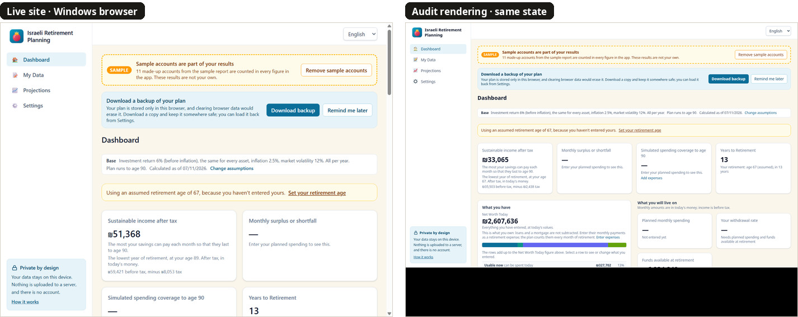

*Figure 1. The live site in a Windows browser (left) and the audit rendering of the same state (right).*

### Screens captured

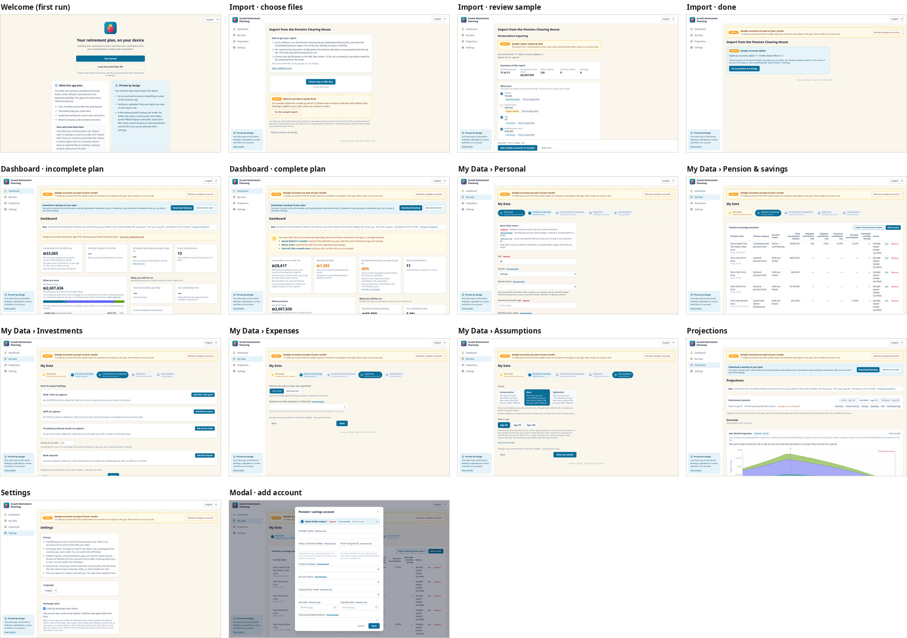

*Figure 2. Desktop states (1440 × 900), first screen of each. Full-page versions are in `gimlai-design-audit-assets.zip`.*

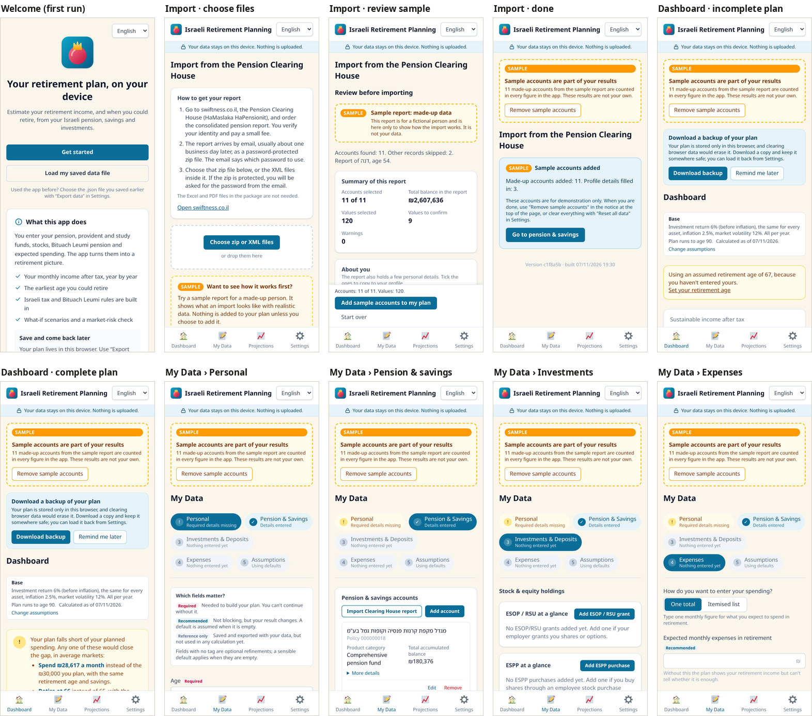

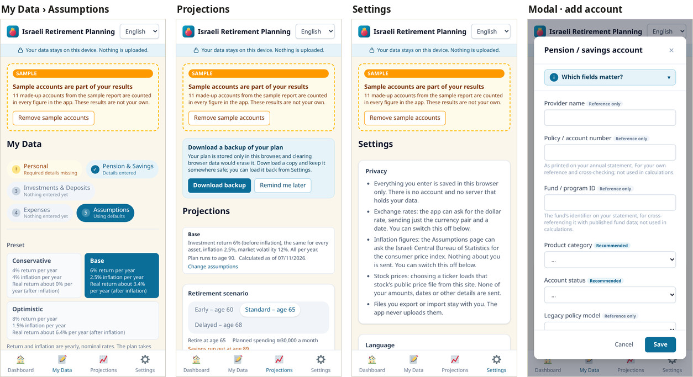

*Figure 3. Phone states (390 × 844), first screen of each.*

## What already works

Several choices are good and should survive any redesign. The brand pairing of Mediterranean blue with a warm stone page is distinctive and appropriate for a calm, long-horizon financial tool. The code uses logical properties (`ms-`, `pe-`, `start`, `end`) throughout, so Hebrew mirrors correctly, including the sidebar, stepper and table actions, while charts deliberately stay left-to-right. Figures in KPI tiles use tabular numbers. Every chart has a written takeaway and a "Show as table" alternative. The privacy promise is present on every screen without being loud, and motion is restrained.

## Audit findings

Severity reflects how much each issue affects legibility, trust or the perceived quality of the product.

| ID | Area | Finding | Severity |
|---|---|---|---|
| F1 | Hierarchy | Notices outrank the page title; the main result sits below them | High |
| F2 | Typography | No webfont is loaded; 93% of type is 12 to 14 px; 11 sizes including 10 and 11 px | High |
| F3 | Colour | Cool slate greys on a warm page; 8 hue families; helper text and inputs fail contrast | High |
| F4 | Components | 17 button styles, 29 copies of the card string, 3 notice styles, pills with two meanings | High |
| F5 | Mobile | Header, privacy strip and two notices fill the first screen; stepper and segmented controls wrap | High |
| F6 | Forms | 1.48:1 input borders, 14 px input text (iOS zooms on focus), focus shown only by border colour | Medium |
| F7 | Tables | Ten columns that wrap to four lines, repeated source text, a red "Remove" on every row | Medium |
| F8 | Charts | Rainbow palette (indigo, purple, pink, magenta) unrelated to the brand; heavy hatching | Medium |
| F9 | Layout | Four different content widths; unbalanced dashboard columns; an empty desktop header bar | Medium |
| F10 | Iconography | Emoji navigation icons render differently on every platform; mixed text glyphs as icons | Medium |
| F11 | Writing style | Title Case and sentence case mixed in headings and labels | Low |

### F1. Hierarchy and page structure

Figure 4 shows the Dashboard with a complete plan. The two notices at the top (3 and 4) are the most saturated, most bordered elements on the screen, and the page title (5) is smaller than either and sits below them. The assumptions line (6) is boxed like a card although it is metadata. The shortfall callout (7) is the fourth tinted-box style on one screen. The four KPI tiles (8) carry up to five lines of 12 px explanation each, so they end at different heights and the figures compete with their own footnotes; a label that wraps (9) pushes its figure out of line with the others.

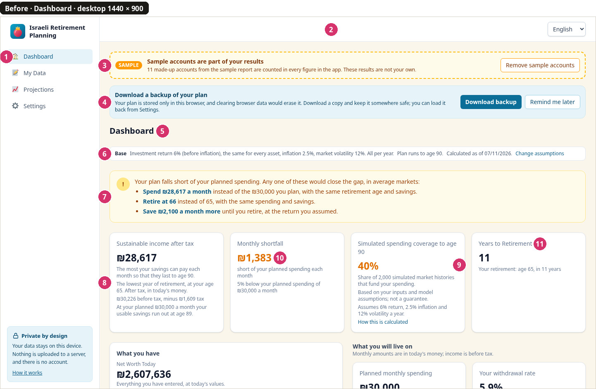

*Figure 4. Dashboard (desktop, complete plan). Numbers refer to findings in this section and the sections that follow.*

Recommendation: give notices one compact, quiet pattern; set the page title at 28 px so it is the largest text on the page; turn the assumptions box into a meta line under the title; and give KPI tiles a fixed anatomy (label, figure, a hairline, explanation) with equal heights and aligned figures.

### F2. Typography

The font stack starts with Inter and Noto Sans Hebrew, but no font file is ever loaded, so almost no visitor sees Inter. Typography therefore changes with the operating system, and Hebrew and Latin may come from unrelated families on the same line.

Of 599 font-size classes in the code, 289 are `text-xs` (12 px) and 269 are `text-sm` (14 px); `text-base` is used 6 times. Eleven sizes are in use, including arbitrary 10, 11, 13 and 15 px values. Card titles are 14 px, the page title is 20 px and KPI figures are 24 px, so the scale is too flat to express hierarchy. For an audience that skews towards people approaching retirement, this density is the single biggest legibility issue in the product.

Recommendation: self-host Inter (variable, Latin and Cyrillic subsets) and Noto Sans Hebrew (variable) with `unicode-range`, and adopt the scale in the design system section: 34, 28, 22, 18, 16, 15 and 13 px, with 13 px as the floor.

### F3. Colour and contrast

The page background is a warm stone (#faf6ec) but every grey is Tailwind's cool, blue-tinted slate, so text and borders look slightly cold against the page. Eight hue families are used for meaning (slate, brand, amber, emerald, red, rose, indigo, sky), with red and rose both meaning "danger". The contrast failures are concentrated in a few tokens, which makes them cheap to fix.

| Element | Colour pair | Today | Required | Proposed |
|---|---|---|---|---|
| Helper and placeholder text | slate-400 on white | 2.63:1 | 4.5:1 | 5.18:1 |
| Secondary text on the page | slate-500 on stone | 4.42:1 | 4.5:1 | 6.04:1 |
| Input and select borders | slate-300 on white | 1.48:1 | 3:1 | 3.24:1 |
| "Sample" badge | white on amber-500 | 2.15:1 | 4.5:1 | 8.13:1 |
| Shortfall figure | amber-600 on white | 3.19:1 | 4.5:1 small, 3:1 at 24 px | 5.03:1 |
| Positive figure | emerald-600 on white | 3.67:1 | 4.5:1 small, 3:1 at 24 px | 5.36:1 |
| Links | brand-700 on white | 7.56:1 | 4.5:1 | unchanged |

Recommendation: replace the slate scale with warm neutrals whose 400 and 500 steps pass 4.5:1, add a dedicated control-boundary colour at 3:1, retire rose in favour of red, and darken the status figures to their 700 steps.

### F4. Component consistency

There is no shared Button, Card or Notice component. The code contains 17 distinct button class sets: primary buttons alone come in four heights between 30 and 40 px, and secondary buttons use four different border colours. The exact card string `rounded-xl border border-slate-200 bg-white p-4 shadow-sm` is repeated 29 times in 21 files. Notices use a dashed amber border (sample data), a tinted blue box (backup) and a solid amber box (assumed age). Grey rounded pills mean "choose a scenario" in one place and "jump to section" a few pixels away on the Projections bar. Importance badges are set at 10 px.

Recommendation: create the six components specified later in this report and migrate to them; the reference patch shows the migration for buttons, cards and notices.

### F5. Mobile

On a phone the first screen holds the header, the privacy strip, the sample notice and the backup notice; the page title starts at 439 px and the first KPI at 898 px, after the first screen has ended (Figure 5). The KPI tiles then stack one per row with their full explanations, so the four headline figures fill most of the second screen. The My Data stepper wraps onto three rows, the Projections scenario control wraps mid-control, the "SAMPLE" pill stretches across the full width like a progress bar, and the active tab in the bottom bar is marked only by a colour change.

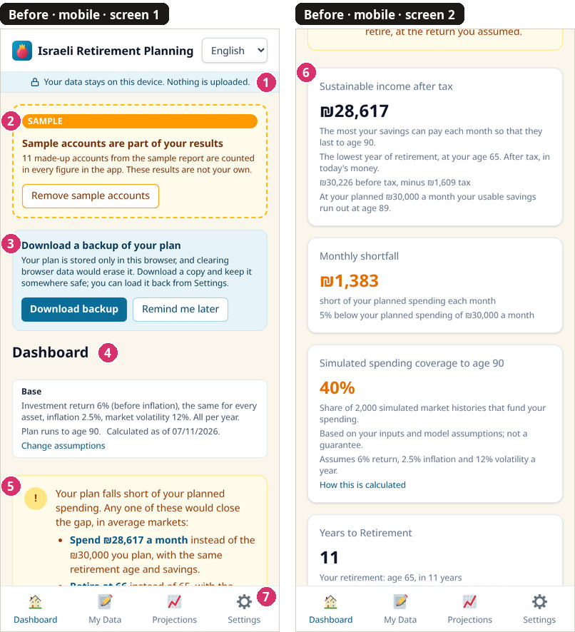

*Figure 5. Dashboard on a phone (390 × 844). 1 header and privacy strip, 2 stretched SAMPLE pill, 3 backup notice, 4 page title at 439 px, 5 status callout, 6 first KPI at 898 px, 7 bottom bar with colour-only active state.*

### F6. Forms

Inputs use a 1px slate-300 border at 1.48:1 against white, so on the white card the fields almost disappear. Input text is 14 px, which makes iOS Safari zoom the page every time a field is focused. Focus is shown only by a change of border colour, and helper text is slate-400 at 2.63:1. On desktop the Personal form occupies a 512 px column inside a 1,152 px canvas, leaving more than half of the screen empty while the "Which fields matter?" legend pushes the first field down (Figure 6).

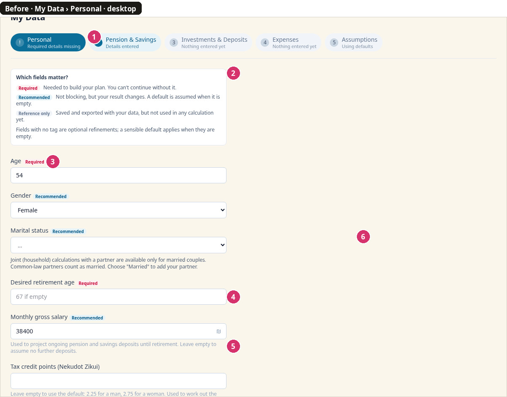

*Figure 6. My Data › Personal. 1 step indicator: active and "needs attention" states share one pill, 2 legend in the reading flow, 3 importance badge at 10 px, 4 input border at 1.48:1, 5 helper text at 2.63:1, 6 unused canvas.*

### F7. Data tables

The Pension and savings table has ten data columns plus actions. Header labels wrap to three lines, "Sample report (made-up data)" wraps to four lines in every row, and every one of the 11 rows ends with a red "Remove" link, so the table is full of red before anything has gone wrong. Account status is plain text, so active and paid-up accounts look the same.

### F8. Charts

Series colours are a Tailwind rainbow: sea blue, teal, indigo, lime, slate, amber, brown, purple, pink and magenta. Indigo, purple and pink do not belong to the brand palette, and the large indigo area for managers' insurance dominates the net-worth chart. Withdrawals are shown with white-on-colour hatching at 3 px, which shimmers at the bar widths used. Axis labels are light grey on white.

### F9. Layout and grid

Pages use four different content widths and two title sizes, so moving between screens shifts the layout under the eye.

| Screen | Content width at 1440 px | Page title | Primary button |
|---|---|---|---|
| Welcome | 448 px hero, 768 px body | 24 px, centred | 40 px, full width |
| Import | 672 px | 20 px | File picker styled as a button |
| Dashboard | 1,152 px (full) | 20 px | 34 px |
| My Data | 1,152 px, form 512 px | 20 px | 36 px; 30 px "Add account" |
| Projections | 1,152 px (full) | 20 px | 34 px |
| Settings | 512 px | 20 px | secondary only |

On the Dashboard the left column ("What you have") ends about 350 px before the right column, leaving a block of empty page. On desktop the header bar is 60 px tall and holds only the language menu.

### F10. Iconography

The four navigation icons are emoji (🏠 📝 📈 ⚙️). They render as different artwork on Windows, macOS, Android and iOS, they do not match the line style of the lock and info icons used elsewhere, and in the sidebar they are the most colourful elements on screen. Status markers are typed characters (✓, !, …) inside circles rather than icons.

### F11. Writing style in the interface

Headings and labels mix Title Case ("Years to Retirement", "Net Worth Projection", "Net Worth Today") with sentence case ("Sustainable income after tax", "Retirement budget"). Sentence case reads more calmly and survives translation better.

## Proposed design system

The system keeps Gimlai's identity (sea blue, Jerusalem stone, the pomegranate) and adds structure underneath it. Four principles guide it: results first, so the user's figures are always the most prominent thing on a page; one way to say each thing, so a notice, a button or a status always looks the same; legible by default, with nothing smaller than 13 px and every text pair at 4.5:1 or better; and calm colour, with the brand colour reserved for actions and amber and red reserved for real warnings.

### Colour

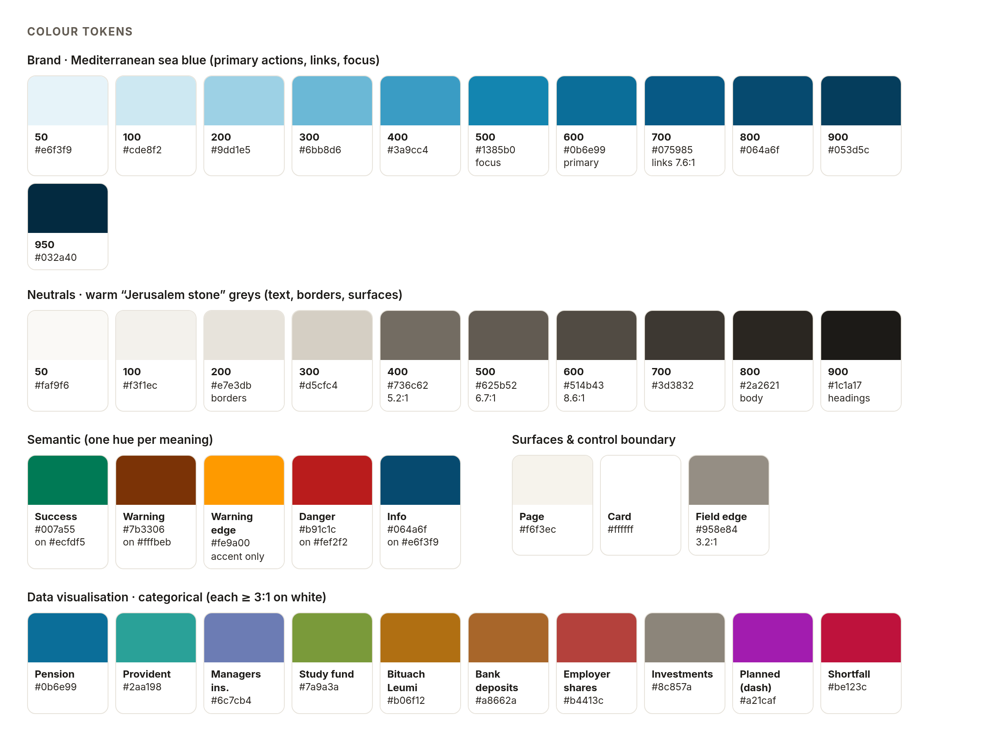

*Figure 7. Colour tokens: brand, warm neutrals, semantic colours, surfaces and the chart palette.*

| Token | Value | Use |
|---|---|---|
| Page | #f6f3ec | App background (lighter, less yellow than today) |
| Card | #ffffff | Every card, table and dialog |
| Border | #e7e3db (neutral-200) | Card and divider lines |
| Control boundary | #958e84 | Input, select and checkbox edges (3.24:1) |
| Text strong | #1c1a17 (neutral-900) | Headings and figures |
| Text | #2a2621 (neutral-800) | Body |
| Text muted | #625b52 (neutral-500) | Secondary text (6.69:1) |
| Text subtle | #736c62 (neutral-400) | Helper text and captions (5.18:1) |
| Primary | #0b6e99 (brand-600) | Primary buttons, selected states |
| Link | #075985 (brand-700) | Links and ghost buttons |
| Focus | brand-500 at 35% | 3 px focus ring |
| Success, warning, danger, info | emerald-700, amber-900 on amber-50, red-700, brand-800 on brand-50 | One hue per meaning |

The chart palette is built from the same Mediterranean family: pension sea blue #0b6e99, provident teal #2aa198, managers' insurance dusty periwinkle #6c7cb4, study fund olive #7a9a3a, Bituach Leumi ochre #b06f12, bank deposits copper #a8662a, employer shares pomegranate #b4413c and other investments stone #8c857a. Each reaches at least 3:1 against white, and neighbouring series differ in lightness as well as hue so they stay distinct for colour-blind readers.

### Typography

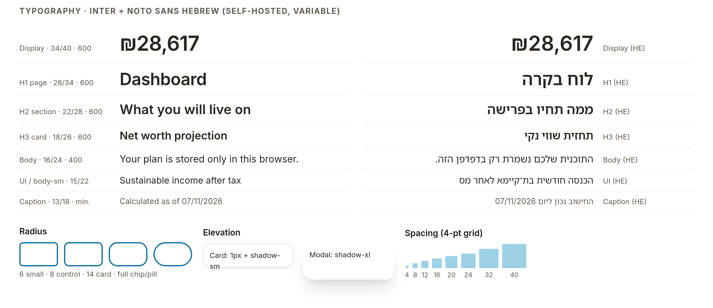

*Figure 8. Type scale in Inter and Noto Sans Hebrew.*

| Role | Size and line height | Weight |
|---|---|---|
| Display figure | 34 / 40 | 600, tabular |
| Page title (H1) | 28 / 34 | 600 |
| Section title (H2) | 22 / 28 | 600 |
| Card title (H3) | 18 / 26, or 16 / 24 in dense cards | 600 |
| Body | 16 / 24 | 400 |
| Interface text | 15 / 22 | 400 to 500 |
| Caption and helper (minimum) | 13 / 18 | 400 |

Three weights are enough (400, 500, 600). Numbers in tables, KPI tiles and chart axes use tabular figures. Headings and labels use sentence case.

### Spacing, shape and elevation

Spacing follows a 4 px grid: 4, 8, 12, 16, 20, 24, 32 and 40. Cards use 20 px padding (24 px from the small breakpoint), sections are separated by 24 to 32 px, and form fields by 20 px. Radii are 6 px for small controls, 8 px for buttons and inputs, 14 px for cards and full for chips and pills. There are two elevations only: cards have a 1 px border with a very soft shadow, and dialogs use the large shadow.

### Components

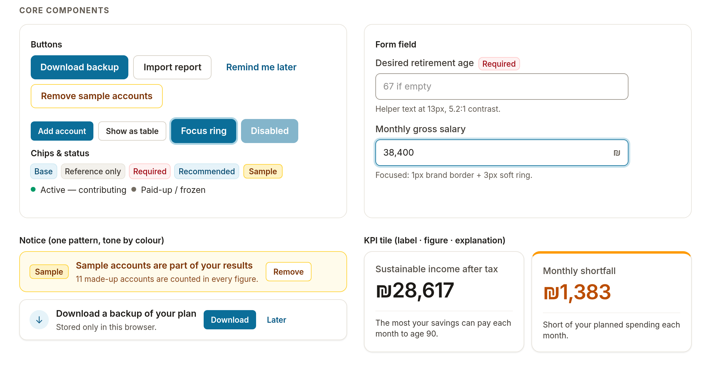

*Figure 9. Core components rendered from the proposed stylesheet.*

| Component | Anatomy and rules | Variants |
|---|---|---|
| Button | 40 px tall (32 px small), 8 px radius, 15 px semibold, 3 px focus ring | Primary, secondary, ghost, warning; danger only inside confirmation dialogs |
| Card | White, 1 px border, 14 px radius, 20 to 24 px padding; title 16 to 18 px | Plain, with toolbar, with footer |
| Notice | Icon or badge, title, one-line body, actions on the end; 1 px border, tinted for tone | Info (white), warning (amber), success, sample |
| Chip | 13 px medium, 6 px radius, 1 px ring | Neutral, info, success, warning, danger, sample |
| Field | Label 15 px, optional chip, 44 px control, 16 px text on phones, 13 px helper | Default, focus, error, disabled, with suffix |
| KPI tile | Label, 28 to 34 px figure, hairline, explanation; equal heights; 4 px top edge for warning or success | Neutral, warning, success |
| Step indicator | Numbered circles with label and status in one bar; scrolls on phones instead of wrapping | Done, current, needs attention, upcoming |
| Segmented control | Raised white segment on a neutral track | Never used for navigation |
| Table | Tinted header, 14 px body, 12 px vertical padding, status dots, icon row actions | Dense, cards on phones |
| Navigation | 20 px line icons, 44 px rows, active fill with a 4 px start-edge bar; bottom bar uses an active pill | Sidebar, bottom bar |

## Concrete styling recommendations

The work splits into three phases. Each is independent and can ship on its own.

### Phase 1: token layer and fonts (about one day)

Replace the top of `app/src/index.css` with a token layer. Because the app uses Tailwind classes everywhere, redefining the theme variables changes every screen at once without touching a component. The essential part is below; the full file is `reference/design-tokens.css`.

```css
@font-face { font-family: "Inter"; font-weight: 100 900; font-display: swap;
  src: url("/fonts/inter-latin-wght-normal.woff2") format("woff2-variations");
  unicode-range: U+0000-00FF, U+0131, U+0152-0153, U+2000-206F, U+20AC, U+2122, U+2212; }
@font-face { font-family: "Noto Sans Hebrew"; font-weight: 100 900; font-display: swap;
  src: url("/fonts/noto-sans-hebrew-hebrew-wght-normal.woff2") format("woff2-variations");
  unicode-range: U+0590-05FF, U+200C-2010, U+20AA, U+FB1D-FB4F; }

@theme {
  --font-sans: "Inter", "Noto Sans Hebrew", ui-sans-serif, system-ui, "Segoe UI", Roboto, sans-serif;
  --text-xs: 0.8125rem;  --text-xs--line-height: 1.125rem;   /* 13 px floor */
  --text-sm: 0.9375rem;  --text-sm--line-height: 1.375rem;   /* 15 px */
  --text-xl: 1.375rem;   --text-2xl: 1.75rem;  --text-3xl: 2.125rem;
  --color-slate-200: #e7e3db;  --color-slate-300: #d5cfc4;
  --color-slate-400: #736c62;  --color-slate-500: #625b52;  /* 5.2:1 and 6.7:1 */
  --color-slate-600: #514b43;  --color-slate-800: #2a2621;  --color-slate-900: #1c1a17;
  --color-field: #958e84;                                     /* 3.2:1 control edge */
  --color-rose-50: #fef2f2;  --color-rose-700: #b91c1c;      /* one danger hue */
  --color-surface: #f6f3ec;
}
```

Redefining the slate scale is a deliberate shortcut that warms every grey in one step. For the longer term, rename the neutrals to semantic tokens (`text-muted`, `border-subtle`) with a search and replace so the names say what they mean.

### Phase 2: shared components (two to three days)

Add component classes (or React components) and migrate the duplicated strings to them. The class layer used in the reference build:

```css
@layer components {
  .btn { @apply inline-flex h-10 items-center justify-center gap-2 rounded-lg px-4 text-sm font-semibold
         focus-visible:outline-none focus-visible:ring-3 focus-visible:ring-brand-500/35; }
  .btn-sm { @apply h-8 rounded-md px-3 text-xs; }
  .btn-primary   { @apply bg-brand-600 text-white hover:bg-brand-700; }
  .btn-secondary { @apply border border-slate-300 bg-white text-slate-800 hover:bg-slate-50; }
  .btn-ghost     { @apply text-brand-700 hover:bg-brand-50; }
  .card   { @apply rounded-[var(--radius-card)] border border-slate-200 bg-white p-5 shadow-sm sm:p-6; }
  .notice { @apply mb-3 flex items-center gap-3 rounded-xl border px-4 py-3 text-sm; }
  .chip   { @apply inline-flex items-center gap-1 rounded-md px-1.5 py-0.5 text-xs font-medium; }
  .field-control { @apply rounded-lg border border-field bg-white text-base md:text-sm
         focus-within:border-brand-600 focus-within:ring-3 focus-within:ring-brand-500/25; }
}
```

### Phase 3: screen-level changes (three to five days)

| File | Change |
|---|---|
| `app/AppShell.tsx` | SVG line icons replace emoji; active item gets a fill and a start-edge bar; the empty desktop header is removed and the language menu moves to the sidebar foot; content is capped at 1,216 px; the bottom bar gets an active pill and safe-area padding |
| `components/KpiCard.tsx` | Label, 28 to 34 px figure, hairline, explanation; equal heights; aligned figures; coloured top edge for warning and success; explanations collapse behind "More details" on phones (needs UX sign-off) |
| `pages/Dashboard.tsx` | Page title at 28 px; 2 × 2 KPI grid on phones; net-worth chart moved directly after the KPIs; "What you have" and "Retirement budget" share the left column to balance the right (order change needs UX sign-off) |
| `components/StatusBanner.tsx`, `ActiveAssumptions.tsx` | Callout with a 4 px start-edge accent and a 16 px semibold message; assumptions become a meta line with a preset chip |
| `SampleDataBanner.tsx`, `SampleBanner.tsx`, `BackupReminder.tsx` | One notice pattern; solid 1 px borders instead of dashed; "Sample" badge at 8.13:1 |
| `components/Stepper.tsx`, `MyDataLayout.tsx` | One bar of numbered steps that scrolls on phones; form in a card with the field legend in a side rail on wide screens |
| `fields/*.tsx`, `FieldLabel.tsx` | 44 px controls at 3:1, 16 px text on phones, focus ring, 13 px badges and helper text |
| `SummaryTable.tsx`, `RowActions.tsx`, `PensionSummaryTable.tsx` | Tinted header, 14 px body, status dots, source shown as a chip under the provider, icon buttons for edit and remove with red only on hover |
| `PlanBar.tsx`, `AssumptionsStep.tsx`, `ExpensesStep.tsx` | Segmented control with a raised selected segment; section links styled as links, not pills; selected presets shown with a ring and tint rather than a solid fill |
| `charts/incomeBandColors.ts`, `portfolioColors.ts`, `chartPalette.ts`, `IncomeBreakdownChart.tsx` | Brand-led palette; hatching drawn as a darker stripe on a 55% tint of the same colour |
| `i18n/locales/en.json` | Sentence case for the four Title Case strings |

## Alternative designs

Every image in this section was rendered from the patched app with the same data as the "before" image.

### Dashboard on desktop

The notices become one quiet pattern, the title becomes the largest text, and the KPI tiles share one anatomy with aligned figures and a coloured edge only where something needs attention. The sidebar uses line icons, the empty header bar is gone, and the language menu sits with the privacy note.

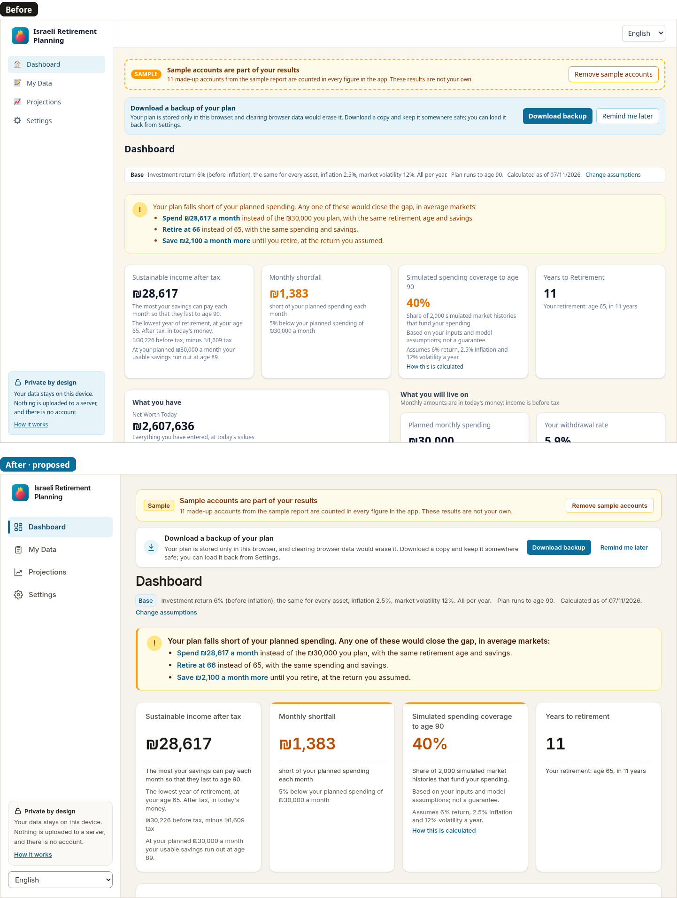

*Figure 10. Dashboard (desktop, complete plan), before and after.*

### Dashboard on a phone

The four headline figures move from a single column that fills the second screen to a 2 × 2 grid that takes less than half of it, with each explanation one tap away. The bottom bar shows the active section with a pill as well as colour.

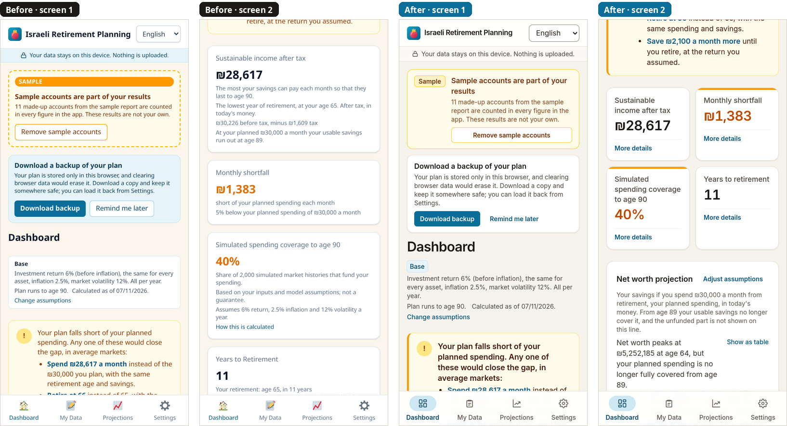

*Figure 11. Dashboard on a phone, first two screens, before and after.*

### My Data forms

The step indicator becomes one bar of numbered steps. The form sits in a card at a comfortable reading width, with the field legend in a side rail instead of the reading flow. Fields are 44 px tall with visible edges and a focus ring, and importance badges are readable.

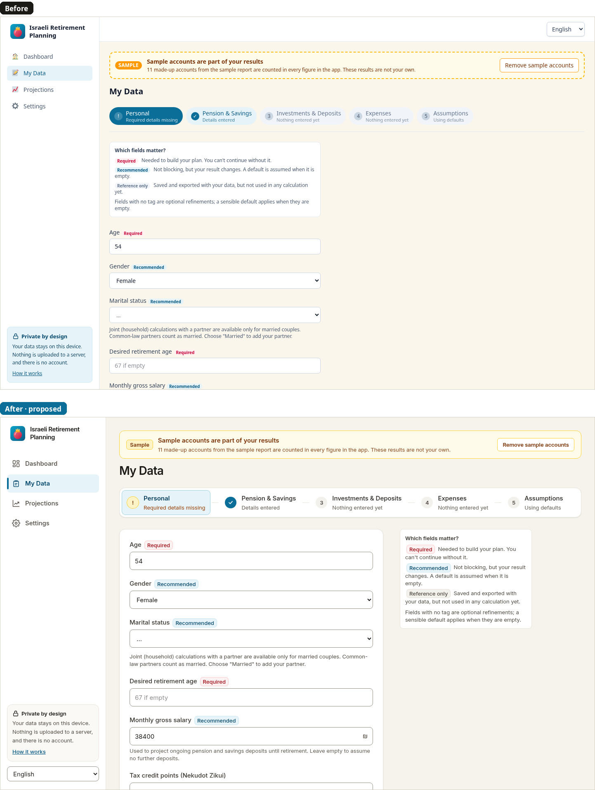

*Figure 12. My Data › Personal (desktop), before and after.*

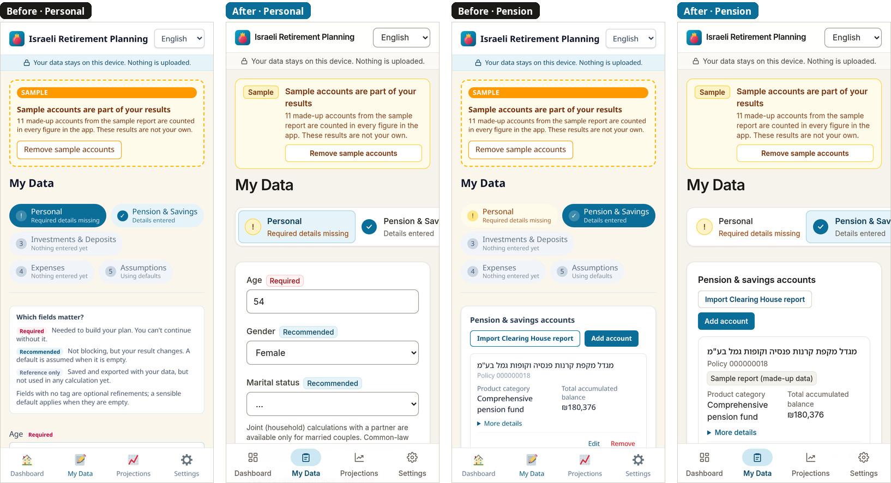

*Figure 13. My Data on a phone: the step indicator scrolls instead of wrapping onto three rows.*

### Pension and savings table

The table now fits at 1440 px without horizontal scrolling. Status is a coloured dot, the data source is a chip under the provider name, and edit and remove are quiet icon buttons that turn red only on hover.

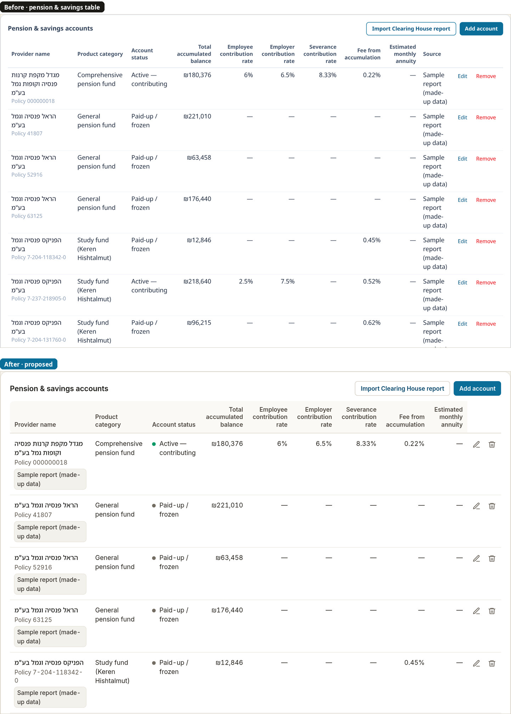

*Figure 14. Pension and savings table, before and after.*

### Projections

The scenario control reads as a segmented control and the section links read as links, so the two no longer look alike. The chart uses the brand-led palette and softer hatching.

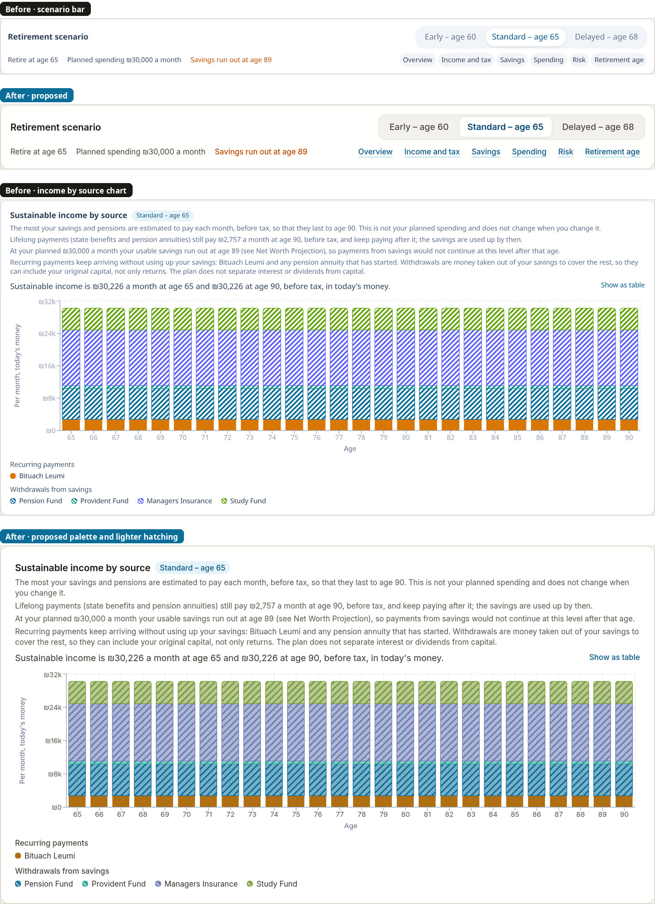

*Figure 15. Projections: scenario bar and "Sustainable income by source", before and after.*

### Step indicator and selection controls

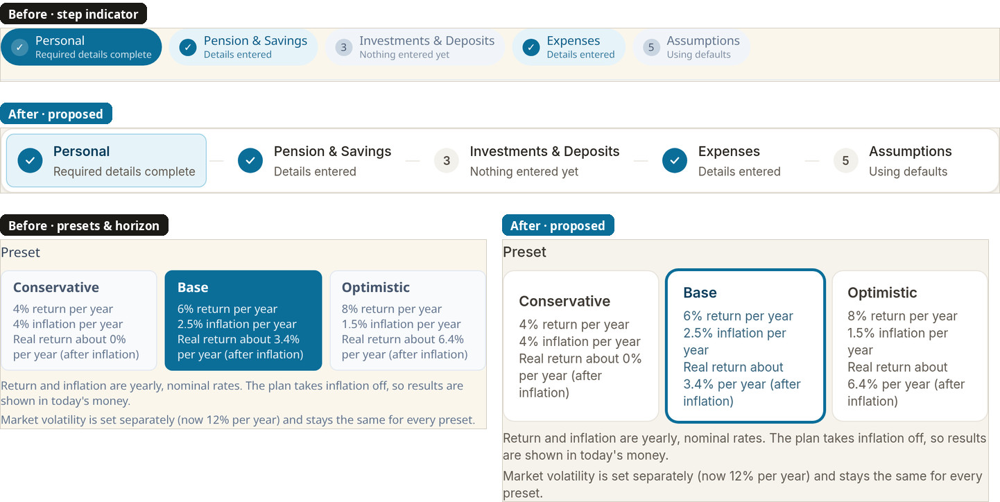

*Figure 16. Step indicator and assumption presets. Selected options use a ring and tint instead of a heavy solid fill.*

### Hebrew, right to left

The design mirrors cleanly: the sidebar, the active-item bar, the callout accent and the KPI edges all move to the start side, and Hebrew is set in Noto Sans Hebrew alongside Inter for Latin and figures.

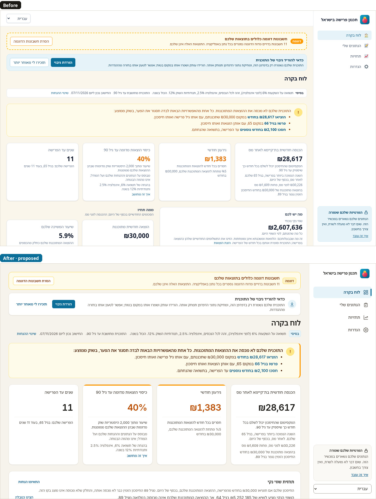

*Figure 17. Hebrew dashboard (desktop), before and after.*

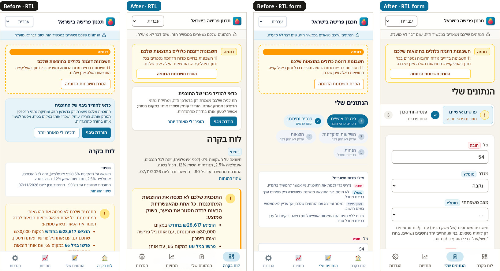

*Figure 18. Hebrew dashboard and Personal step on a phone, before and after.*

### Welcome

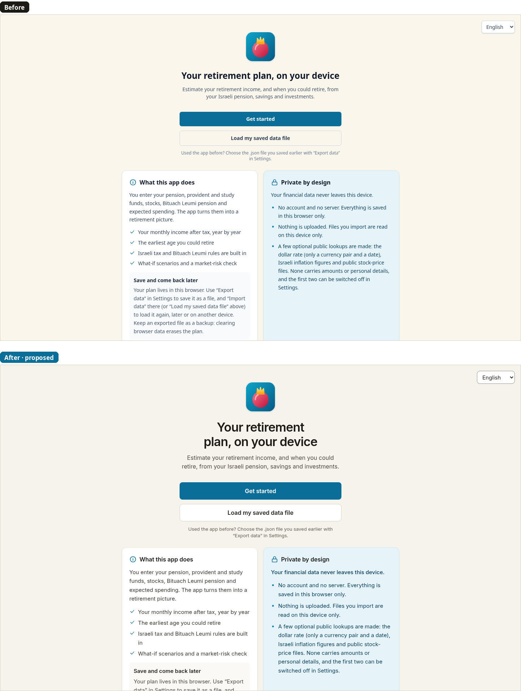

*Figure 19. Welcome page: larger title, 48 px primary actions and the shared card style.*

## Roadmap

| Phase | Scope | Effort | Risk |
|---|---|---|---|
| 1. Tokens and fonts | `index.css` theme, two font files, sentence case | About 1 day | Low: class names unchanged; spot-check wrapping at 15 px |
| 2. Shared components | Button, Card, Notice, Chip, Field, KPI tile; migrate duplicated strings | 2 to 3 days | Low to medium: visual regression on every screen |
| 3. Screen changes | App shell, Dashboard, My Data, tables, Projections, charts | 3 to 5 days | Medium: dashboard order and collapsed KPI notes need UX sign-off |

Two follow-ups are outside the patch. Add the Inter Cyrillic subset before shipping Russian with the new font, and run the Russian screens through the same capture, since Russian labels are the longest and will show any wrapping the larger type scale introduces.

## About the accompanying files

| Path in this folder | What it is |
|---|---|
| `reference/redesign.patch` | Git patch against commit c1f8a5b implementing everything shown in the alternative designs (78 files, including two WOFF2 font files). A reference implementation, not a drop-in: adopt Phase 1 as is and take Phases 2 and 3 component by component. |
| `reference/design-tokens.css` | The proposed `app/src/index.css`: fonts, tokens and component classes. |
| `figures/` | The annotated and before/after figures used in this document. |
| `design-system/` | Token, type and component specimen sheets. |
| `screenshots/after/<lang>-<device>/` | The proposed design rendered from the patched app: `desktop` is 1440 × 900, `mobile` is 390 × 844 at 2× density. `-fold` files show the first screen; `*-full/part-NN.png` folders split a full page into screen-height parts. |
| `screenshots/components/before/` and `after/` | Component crops at 2×: KPI tiles, pension table, step indicator, presets, scenario bar, charts, sidebar. |

The complete capture set (72 screenshots of the current app, desktop and phone, English and Hebrew, plus the live-site comparison) is in the separate archive `gimlai-design-audit-assets.zip`.
