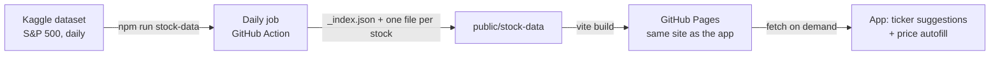

# Stock price data (Phase T)

Helps with entering stock holdings: a daily job caches the price history of the S&P 500
stocks as one JSON file per stock and publishes it with the app. In the "Stock / equity
holding" dialog the ticker field suggests those stocks, and once the ticker is one of
them the app fills the share price on the purchase or grant date, today's price and the
company name. The user can type their own values at any time.

**No tax or retirement calculation changed.** The prices only fill form fields that the
user could always type by hand.

## How it works



1. **The job** (`app/scripts/stock-data/`, TypeScript, run with `npm run stock-data`)
   downloads the dataset zip, streams the big CSV, and writes `public/stock-data/`. It
   needs no extra packages beyond `@zip.js/zip.js`.
2. **The workflow** (`.github/workflows/deploy.yml`) runs daily (05:17 UTC), on every
   push to `main`, and by hand. The last good set of files lives in the Actions cache,
   so a normal push does not download the dataset again. If the refresh fails, the app
   is still deployed with the cached files, and a warning is shown on the run. If there
   is no cache either, the app is deployed without price files and works as before.
3. **The app** (`app/src/stockPrices/`, `MyData/useStockPriceAutofill.ts`) fetches
   `stock-data/_index.json` once (the suggestions) and `stock-data/<TICKER>.json` only
   when the typed ticker is in the list.

The job refuses to publish a set that looks wrong: fewer than 400 symbols, or a newest
price older than 7 days (`--min-symbols`, `--max-age-days`). New files are written next to
the old ones and swapped in only when complete.

## File format

Shared by the job and the app in `app/src/stockPrices/format.ts`.

- `_index.json`: `{ generatedAtUtc, source, symbols: [{ symbol, name, firstDate, lastDate }] }`
- `<TICKER>.json`: `{ symbol, name, asOf, priceBasis, dates: [...], close: [...] }`. Two
  parallel lists, oldest first, rounded to 4 decimals. About 35–140 KB per stock, 58 MB
  in total (about 17 MB gzipped, which is what a visitor downloads; and only the stocks
  they type).

Prices on non-trading days: the app uses the last trading day on or before the date
(`priceOnOrBefore`), up to 10 days back. Beyond that, nothing is filled.

## Form behavior

- Typing a ticker offers the S&P 500 list with company names; any other ticker is still
  accepted and nothing is filled.
- An empty field is filled the first time only. A field is refreshed (for example when
  the date changes) only while it still holds the value that was filled. A typed value is
  never overwritten, and a value the user deleted does not come back.
- Changing the ticker removes what was filled for the old one.
- A small note under the date and price says which trading day the price is from.
- When the files cannot be loaded (offline, local dev without data, CI) the form behaves
  exactly as before.

## Important limitation: prices are dividend-adjusted

The Kaggle `close` column is Yahoo's *adjusted* close (adjusted for splits **and**
dividends), not the price actually quoted that day. Today's price is exact. An older
price is too low by about the dividends paid since:

| Stock | Date | Quoted close | Kaggle / adjusted close | Difference |
|---|---|---|---|---|
| KO | 2015-06-15 | 39.59 | 27.90 | about −30% |
| KO | 2022-06-02 | 63.73 | 55.91 | about −12% |

Stocks that pay no dividend (for example AMZN) differ only by splits, so the dataset is
right for them. For tax this matters (a lower purchase price means a higher computed
gain), so the dialog says that prices are adjusted and to check them against the broker
statement. The user accepted this for now ("keep Kaggle for now … label the past price
clearly as an approximation").

The source can be swapped without touching the app, as long as the job writes the same
file format. A better source would give real closes adjusted for splits only (see below).

## Open items

- **License.** The Kaggle dataset's terms (and the Yahoo data underneath) have not been
  verified for republishing in a public repo's Pages site. Check before relying on it.
- **Better source.** Real closing prices, split-adjusted only. Candidates: the Yahoo chart
  API (has both `close` and `adjclose`, but is unofficial, against its terms for some uses
  and may block GitHub runners), or a keyed provider (Tiingo, Twelve Data, etc.; the key
  would be a repository secret).
- **Coverage.** Current S&P 500 members only. Israeli-employer stocks such as CHKP and WIX
  are not there, nor are former members.
- **Ticker spelling.** Share classes (BRK-B vs BRK.B) may need a mapping.
- **Privacy.** The app has no backend, and this is a plain static file request to the
  same site, but the request does reveal the ticker to the Pages host. A Settings switch
  to turn lookups off could be added.
- **Schedule pause.** GitHub pauses scheduled workflows after 60 days without repository
  activity. Any push (or a manual run) restarts them.
- **Secrets.** The download works anonymously today. If Kaggle starts requiring a login,
  add `KAGGLE_USERNAME` and `KAGGLE_KEY` as repository secrets; the workflow already
  passes them when present.
- **First run.** The workflow cannot be tested locally. Run it once with "Run workflow"
  after the first push and check the "Refresh stock price files" step.

Later ideas, not started: the 30-trading-day average price that some employers use as the
Section 102 grant-date value, and a USD/ILS rate history.

## Running it locally

```
cd app
npm run stock-data                       # downloads from Kaggle, writes public/stock-data
npm run stock-data -- --zip data.zip     # use a zip that is already on disk
npm run stock-data -- --out some/folder  # write somewhere else
```

`public/stock-data` is ignored by git. `npm run dev` and `npm run build` serve or copy it
when it exists.
